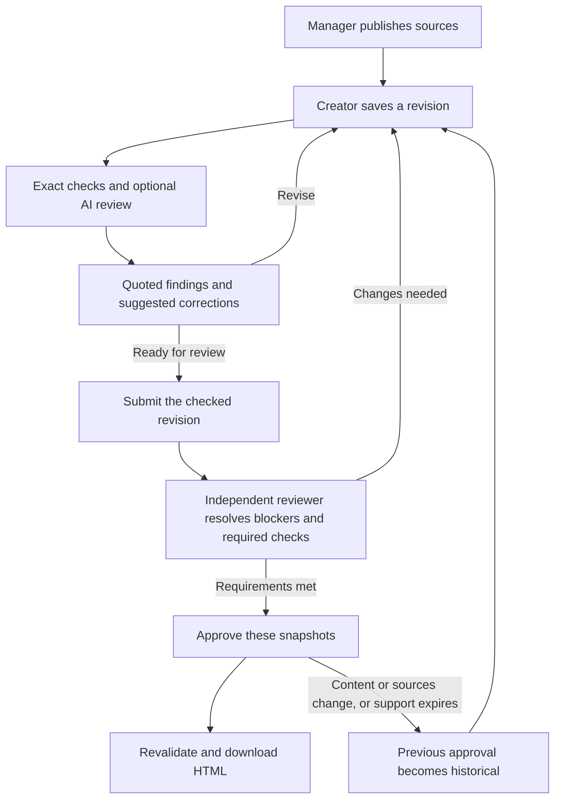
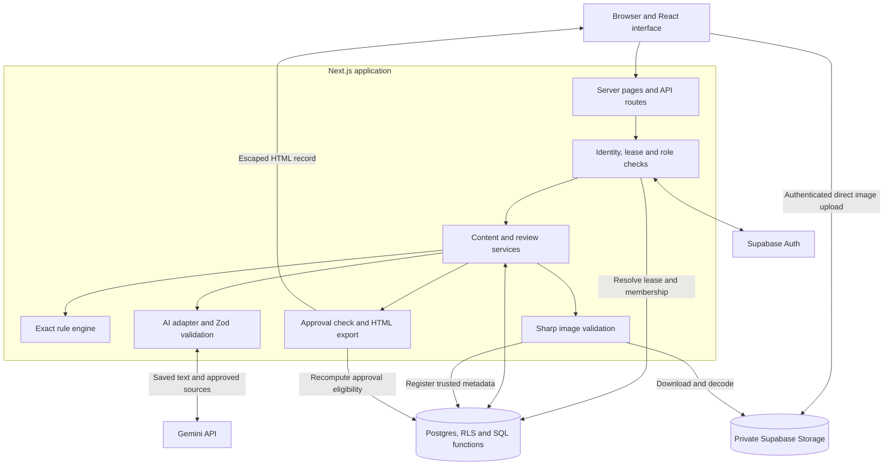
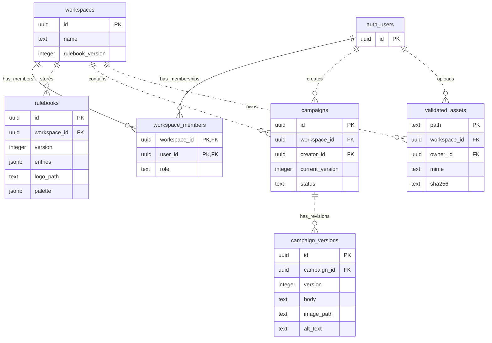
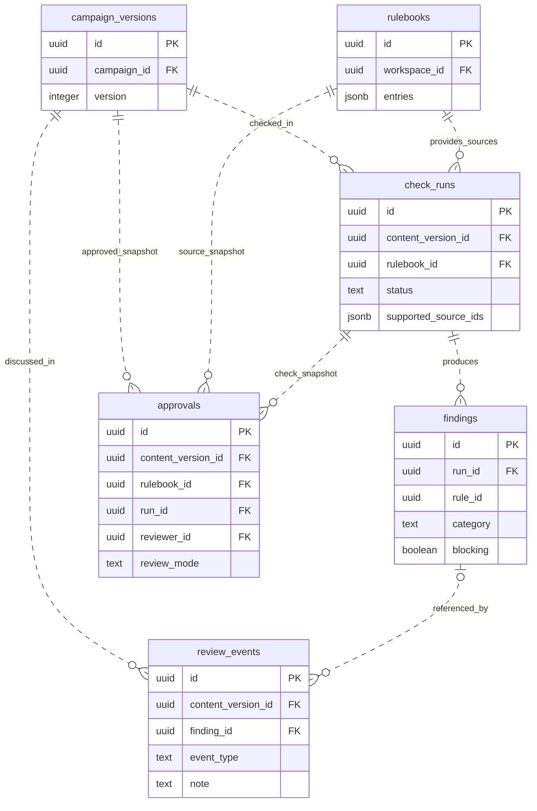
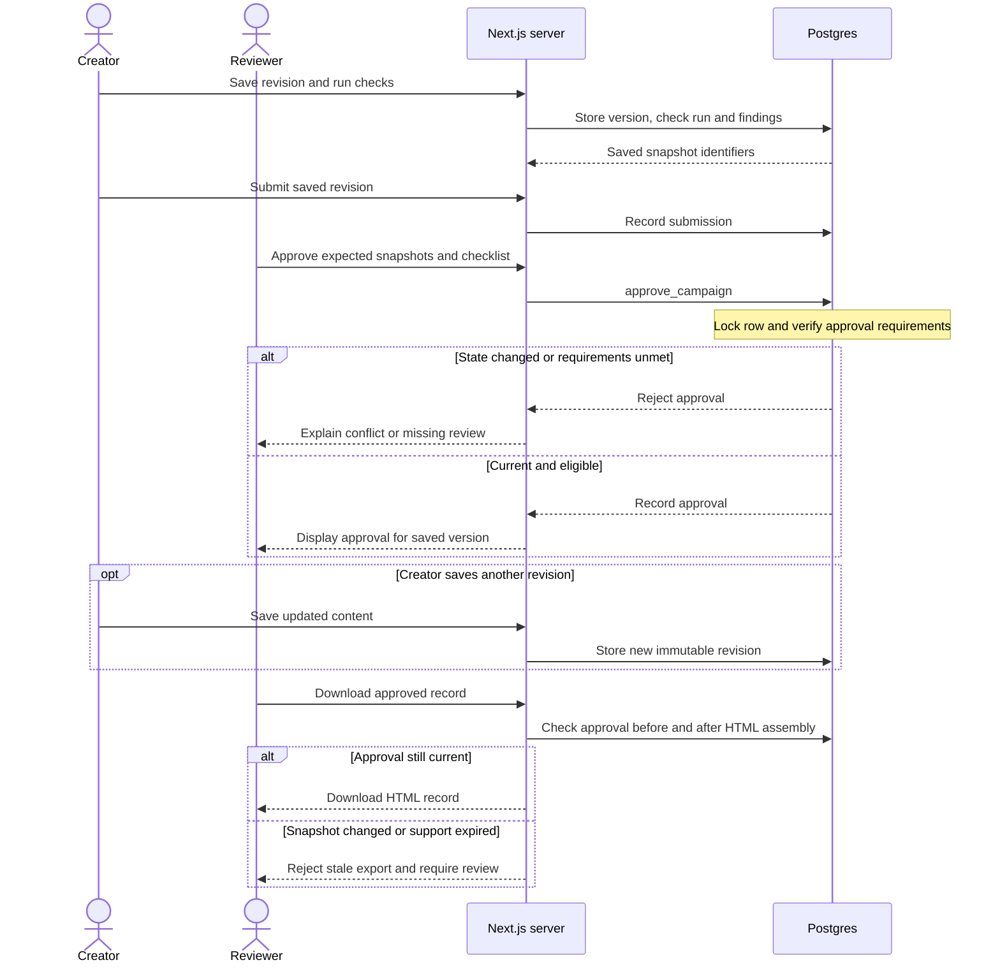

# Brand Review Desk

Brand Review Desk helps a marketing team check campaign content against approved facts, guidelines and assets before publication. Creators get specific feedback, make corrections and send a saved revision to a separate reviewer. The final decision stays with a person.

For example, SampleCo offers a **14-day trial**, but a draft promises **30 days**. The app identifies the conflict, points to the approved fact and suggests a correction. Approval belongs to the version that was reviewed, so later edits cannot silently reuse it.

**[Open the live demo](https://brand-review-desk.vercel.app/)** · **[Browse the source](https://github.com/Tvaibhav06/code-axis)**

[Workflow](#workflow) · [Architecture](#architecture) · [Data model](#data-model) · [Run locally](#run-locally) · [Testing](#testing) · [Known limitations](#known-limitations)

## What the app supports

| Area | Capability |
|---|---|
| Approved sources | Versioned guidelines, facts, terminology, owners, references, validity dates, logo and palette |
| Campaigns | Purpose, audience, English copy, numbered revisions, an optional private image, and an attached PDF brief |
| Image text OCR (Round 3) | Server-side OCR text extraction from PNG/JPG with human confirmation and cross-modal claim checks |
| PDF document review (Round 3) | Private text PDFs up to 5 pages, 2 MB and 1,500 words with page-mapped text extraction and review checks |
| Guideline import (Round 3) | Manager extraction of rule candidates from PDF briefs with editing and explicit versioned publishing |
| Explainable checks | Supported terminology/fact checks and optional AI findings with quoted text and source references |
| Human review | Comments, clarification, reasoned decisions, submission and independent approval |
| Approval safeguards | Content/source/run binding, unresolved-blocker gates, relevant expiry checks and stale-export rejection |
| Image review | Validated uploads, alt text, manual visual checks and contrast for a selected colour pair |
| History and handoff | Paged revision history, deduplicated issue counts and a downloadable HTML review record |

The demo and AI integrations have [known limitations](#known-limitations). A successful build or homepage response does not establish that a deployed review journey passes end to end.

## Roles

| Role | Responsibilities |
|---|---|
| Creator | Save drafts, run checks, apply chosen corrections and submit revisions |
| Manager | Publish approved sources/assets and answer clarification requests |
| Reviewer | Inspect submitted content, resolve findings, request changes and approve independently |

The demo uses separate authenticated accounts for these roles. Role checks are enforced on the server and in database functions, not just by hiding interface controls.

## Workflow

Checks always use saved copy and a published source snapshot. An AI request is optional; an incomplete response requires explicit manual review rather than being treated as a clean result.



Suggestions do not overwrite copy automatically. A creator chooses a correction and saves a new revision. Clarification notes also do not change approved facts; managers must publish an updated source snapshot for that.

## Architecture

The interface, server-rendered workspace and API routes live in one Next.js application. Protected requests validate the active identity, demo lease and workspace role. Ordinary product reads/writes use the signed-in user's Supabase permissions.



| Component | Technology |
|---|---|
| Application | Next.js App Router, React, TypeScript and Node.js |
| Identity and data | Supabase Auth, Postgres and Row Level Security |
| Files and images | Private Supabase Storage (`brand-assets`, `brand-documents`) and Sharp |
| Image OCR | Tesseract.js engine with server-side text recognition and human confirmation |
| Document extraction | `pdf-parse` / `pdfjs-dist` text stream extraction (up to 5 pages, 2 MB, 1,500 words) |
| Review & validation | TypeScript exact rules, optional Gemini REST API and Zod structured parsing |
| Hosting | Vercel / Render.com |
| Verification | Vitest, real-account permission checks and Playwright |

Dependency versions are pinned in [package.json](package.json) and [package-lock.json](package-lock.json). The project requires Node.js 22 as declared in its engine settings.

Trusted server access is restricted to demo allocation, recording validated check results and registering decoded assets after access checks. The browser cannot forge trusted AI results or image-validation metadata. Server keys and the private account manifest never belong in client code.

## Data model

The diagrams show the principal tables and selected columns. They omit some repeated user/workspace foreign keys for readability. `auth_users` represents Supabase's `auth.users`; application tables are in the `public` schema.

### Content and workspace access



Each rulebook is an immutable publication. Individual source entries live inside `rulebooks.entries` as JSON, not in a separate sources table. `logo_path` and `image_path` are checked storage-path references, not SQL foreign keys to `validated_assets`.

### Checks, decisions and approval



`review_events.finding_id` is nullable because comments and submissions need not target a finding. A finding's `rule_id` identifies a JSON source entry and is validated against its run's rulebook; it is not a foreign key to a separate rule table. Demo slots, leases and allowance settings live in `brd_private` and are excluded from these product diagrams. See [SQL migrations](supabase/migrations) for the complete constraints and policies.

## Approval safeguards

An approval records the content revision, rulebook and check run that were reviewed. The database locks the campaign row while checking eligibility, preventing an approval from silently carrying over to a concurrently saved revision.



The actual checks also enforce independent review, resolved blocking findings and required manual/image checklists. Relevant source expiry is evaluated when approval state is computed. Historical approvals remain readable; they are not proof that the current campaign is approved.

## Use the deployed demo

Open [Brand Review Desk](https://brand-review-desk.vercel.app/) and select **Start demo**. Signup is not required. Each visitor is automatically leased an isolated fictional workspace from the pre-provisioned demo pool.

### Fictional Demo Accounts & Roles

Each demo session automatically provisions three authenticated roles within the workspace:

| Role | Interface access | Actions in demo |
|---|---|---|
| **Creator** | Campaign draft editor | Edits campaign copy, uploads campaign image & brief PDF, runs OCR & checks, submits for review |
| **Manager** | Brand sources & rulebook | Imports guidelines from PDF, edits facts/terminology, uploads approved logo/palette, publishes rulebooks |
| **Reviewer** | Review desk | Inspects diffs, resolves/dismisses findings, verifies manual & visual checklists, approves campaigns |

Use the **Switch role** dropdown at the top of the desk to switch identities seamlessly.

### Manual Test Fixtures

Three manual test fixtures are included in the repository under [`docs/manual-fixtures/`](docs/manual-fixtures/):

1. **`docs/manual-fixtures/sampleco-campaign.png`**:
   - Contains still text: *"Try SampleCo free for 14 days."*
   - Used to test **Image OCR (Improvement 1)**: Upload as campaign image, click **"Read text from this image"**, confirm the extracted text, and run review checks.
2. **`docs/manual-fixtures/sample-guidelines.pdf`**:
   - Multi-page brand brief containing approved trial duration (14 days), monthly price (₹499), brand name guidelines, and messaging rules.
   - Used to test **Multi-Page PDF Extraction (Improvement 2)**: Attach under campaign brief in Creator role.
   - Used to test **Manager Guideline Import (Improvement 3)**: In Manager role under Sources, click **"Import guidelines from PDF"** to extract rule candidates automatically.
3. **`docs/manual-fixtures/sampleco-logo.png`**:
   - Official brand logo PNG for Manager upload and contrast ratio validation.

---

### Step-by-Step Demo Walkthrough

#### 1. Test Defect Detection & Image OCR (Creator)
1. Select **Start demo**. You are signed in as **Creator** on the SampleCo workspace.
2. Under English campaign text, observe the seeded copy promising `30 days free`.
3. Under **Optional campaign image**, upload `docs/manual-fixtures/sampleco-campaign.png`.
4. Click **"Read text from this image"**. Server-side OCR extracts: `Try SampleCo free for 14 days.`.
5. Click **"Confirm image text"**.
6. Click **"Run checks"**. Notice the system flags:
   - Trial duration conflict: Copy claims 30 days while approved brand rule is 14 days.
   - Cross-modal conflict: Copy (30 days) contradicts image text (14 days).

#### 2. Test Multi-Page PDF Extraction (Creator)
1. Under **Optional campaign brief / supporting document (PDF)**, upload `docs/manual-fixtures/sample-guidelines.pdf`.
2. The server extracts the text and displays **Attached document (2 pages)** with an expandable text preview.
3. Correct the campaign body to: `Try SampleCo free for 14 days.`.
4. Save the campaign version and choose **Submit saved version for review**.

#### 3. Test Manager Guidelines Import & Rulebook Publishing (Manager)
1. Switch role to **Manager** at the top.
2. Select the **Sources** tab.
3. Click **"Import guidelines from PDF"** and select `docs/manual-fixtures/sample-guidelines.pdf`.
4. The system extracts rule candidates (14 days trial, INR 499 price, brand name terminology, tone) and populates them into editable cards.
5. Click **"Publish source version"**. The rulebook version increments in the database.

#### 4. Test Reviewer Approval & Audit Export (Reviewer)
1. Switch role to **Reviewer**.
2. Notice all prior checks were re-evaluated against the new rulebook version.
3. Verify the manual review checklist (logo, spacing, readability, palette contrast).
4. Click **"Approve version"**.
5. Click **"Download approved HTML review record"** to inspect the cryptographically verified, self-contained audit package.

## Run locally

### Prerequisites and installation

- Node.js 22 and npm.
- A Supabase project with the application migrations applied.
- Internet access: a local Next.js process still uses remote Supabase services.
- Gemini credentials only if you deliberately enable real AI checks.

```bash
git clone https://github.com/Tvaibhav06/code-axis.git
cd code-axis
npm ci
```

On Windows PowerShell, use `npm.cmd` and `npx.cmd` if script execution policy blocks `npm` or `npx`.

### Configure services

If this checkout is already configured, preserve its `.env.local`, account manifest and usage counters. Do not rerun schema creation or recreate accounts simply to start the app.

For a new development project:

1. Copy `.env.example` to `.env.local` only if the latter does not exist. Enter your Supabase URL, publishable key and server-only service-role/secret key.
2. Apply the files in [supabase/migrations](supabase/migrations) once, in filename order. Apply only missing migrations to an existing database.
3. Keep demo entry and AI disabled during setup. A small **new** pool can use `DEMO_POOL_SIZE=2`, `DEMO_AI_ATTEMPT_LIMIT=5`, `GLOBAL_AI_ATTEMPT_LIMIT=0`, `GEMINI_BILLING_TIER=free` and `AI_CHECKS_ENABLED=false`.
4. Run `npm run seed:demo`, followed by `npm run seed:content`. These write real fictional accounts/content to your configured Supabase project. The account manifest and verification credentials are saved privately in `.env.local`.
5. Set `DEMO_ACCESS_ENABLED=true` and `NEXT_PUBLIC_SITE_URL=http://localhost:3137`.

The pool also includes two dedicated verification workspaces. Do not shrink an existing pool, replace a manifest or reset consumed allowance while configuring a checkout.

| Variable | Purpose |
|---|---|
| `NEXT_PUBLIC_SUPABASE_URL` | Supabase project URL |
| `NEXT_PUBLIC_SUPABASE_PUBLISHABLE_KEY` | Browser-safe publishable key |
| `SUPABASE_SERVICE_ROLE_KEY` | Server-only trusted operations and setup |
| `DEMO_POOL_ACCOUNTS_JSON` | Generated private demo-account manifest |
| `DEMO_ACCESS_ENABLED`, `DEMO_POOL_SIZE` | Demo entry and pool configuration |
| `DEMO_AI_ATTEMPT_LIMIT`, `GLOBAL_AI_ATTEMPT_LIMIT` | Database-backed application allowances |
| `AI_CHECKS_ENABLED` | Server switch for real AI requests |
| `GEMINI_API_KEY`, `GEMINI_MODEL`, `GEMINI_FALLBACK_MODEL` | Optional Gemini credentials and model identifiers |
| `GEMINI_BILLING_TIER` | Intended service tier; does not change provider billing |
| `NEXT_PUBLIC_SITE_URL` | Local or deployed app origin |

Never add a `NEXT_PUBLIC_` prefix to server keys or the account manifest. Changing an allowance in a file does not reset usage or automatically update the database setting. Use the setup script intentionally and preserve existing consumption.

### Start the app

After configuration, use PowerShell to start without provider calls:

```powershell
$env:AI_CHECKS_ENABLED = 'false'
npm.cmd run dev -- --port 3137
```

Wait for **Ready**, then open [http://localhost:3137](http://localhost:3137/). Use `localhost` consistently. The terminal override keeps real AI off even if saved settings enable it.

If the port is occupied, stop the earlier server or use another port consistently in the app URL, site setting and browser-test base URL. For a local production build, stop the dev server and run:

```powershell
npm.cmd run build
npm.cmd run start -- --port 3137
```

## Testing

### Rules and code quality

```bash
npm run test:rules
npm run lint
npm run typecheck
npm run build
```

These checks need no Gemini requests. Stop the dev server before building so both processes do not share an output directory. A passing build does not establish that external services or the deployed workflow are healthy.

### Database and storage permissions

With migrations and verification accounts configured:

```bash
npm run test:permissions
npm run smoke:services -- supabase
```

These use real Supabase Auth, database and private Storage. The permission suite writes fictional fixtures in dedicated verification workspaces. Its labelled manual fixtures are not AI accuracy evidence.

### Browser journey

Start the app, then use a second PowerShell terminal:

```powershell
$env:PLAYWRIGHT_BROWSERS_PATH = '.cache/pw-browsers'
npx.cmd playwright install chromium
$env:PHASE6_BASE_URL = 'http://localhost:3137'
$env:PHASE6_AI = 'false'
$env:PHASE6_IMAGES = 'true'
$env:PHASE6_ALLOWANCE_EXHAUSTED = 'false'
npm.cmd run test:browser
```

The journey exercises source/image publication, saved checks, decisions, clarification, approval, actual HTML download, history and invalidation. It allocates a fresh demo workspace and uses real Supabase services. AI-off mode makes no provider calls.

To target the deployed app, set `PHASE6_BASE_URL=https://brand-review-desk.vercel.app` instead. A local server is unnecessary for that run. Check available demo capacity before repeated public runs; used sessions are not automatically recycled.

### Live AI evaluation

`npm run pilot` runs the fixed development cases and makes real provider requests. Primary/fallback smoke modes also call Gemini. Check both provider quota and application headroom before running them; diagnostic scripts must not be used to bypass the application's allowance.

Record failures and unavailable cases separately from successful responses. Exact-rule recovery on an AI failure is not an AI pass. Detailed prior runs and limitations are available under [verification notes](docs/PHASE6_VERIFICATION.md) and [evidence](docs/evidence).

## Deployment

### Option A: Vercel

1. Connect the repository to Vercel with Next.js, Node 22 and the repository root as Root Directory. Configure the intended production branch.
2. Add your environment variables to Production. Keep the service-role key, Gemini key and demo-account manifest secret. Git does not copy `.env.local` to the host.
3. Set `NEXT_PUBLIC_SITE_URL` to the actual HTTPS deployment origin. Enable demo entry only after setup is complete. Preserve the manifest, database usage and configured allowances.
4. Deploy the reviewed commit. Environment changes require a new deployment. Check the source revision and build logs.
5. Verify the public walkthrough while signed out, including the actual download and approval invalidation.

### Option B: Render.com

1. In the [Render Dashboard](https://dashboard.render.com/), choose **New +** $\rightarrow$ **Web Service**.
2. Connect your repository.
3. Configure settings:
   - **Environment:** `Node`
   - **Node Version:** `22` (or set `NODE_VERSION=22` in Environment Variables)
   - **Build Command:** `npm run build`
   - **Start Command:** `npm run start`
4. Add the following environment variables from your `.env.local`:
   - `NEXT_PUBLIC_SUPABASE_URL`
   - `NEXT_PUBLIC_SUPABASE_PUBLISHABLE_KEY`
   - `SUPABASE_SERVICE_ROLE_KEY`
   - `DEMO_POOL_ACCOUNTS_JSON`
   - `DEMO_ACCESS_ENABLED` = `true`
   - `NEXT_PUBLIC_SITE_URL` = your assigned Render URL (e.g. `https://brand-review-desk.onrender.com`)
   - `GEMINI_API_KEY` (if AI checks are enabled)
   - `GEMINI_MODEL` (e.g. `gemini-2.5-flash`)
   - `AI_CHECKS_ENABLED` = `true`
5. Click **Deploy Web Service**. Verify with `/api/health` and test **"Start demo"**.

## AI behavior and privacy

Model identifiers are configuration values in `.env.local` or the hosting environment. If primary and fallback identifiers match, there is no independent fallback. Responses must pass structural, quoted-span and source-ID validation before storage. The request timeout is 25 seconds; there is no automatic retry or model switch.

Per-session and global allowance checks happen before a product AI request. Failed provider attempts and explicit retries count after reservation. A global limit of zero disables product AI calls. Limits are cumulative application controls, not provider billing caps or automatic daily resets.

The text-only Gemini request receives saved copy and approved source entries. Original images remain in private Storage. Free-tier inputs and responses may be used by Google to improve its products, so the public demo accepts fictional data only. See [Gemini's data-use terms](https://ai.google.dev/gemini-api/terms). Handling confidential customer material requires a separate provider and retention review.

## Known limitations

- **AI availability is subject to provider rate limits.** Quota exhaustion and Gemini provider 503 errors can occur on high load or unpaid tiers. The system fails open to deterministic exact-rule checking and manual checklists when AI is offline.
- **Visual styling checks remain human-in-the-loop.** Image OCR and contrast ratios are evaluated automatically, but subjective design layout, logo spacing and brand aesthetics require manual reviewer sign-off.
- **Input scope is bounded.** Pasted English copy up to 1,500 words, up to 30 source entries, attached text PDFs up to 5 pages and 2 MB, and one PNG/JPG up to 5 MB (4,096 pixels per side and 16 megapixels).
- **Publishing integrations are non-automatic.** The application produces an immutable approved HTML review package; campaigns are not automatically published to third-party ad networks.

## Planned extensions

- **DOCX brief ingestion:** Extend the existing document parser to extract and validate Word documents (`.docx`).
- **Multilingual OCR:** Broaden OCR recognition beyond English to multilingual promotional campaigns.
- **Ad network export webhooks:** Deliver approved campaign packages directly to CMS or marketing platforms via signed webhooks.

## Project structure

```text
src/app/                Pages and API route handlers
src/components/         Workspace, review and upload interfaces
src/lib/                Schemas, pure checks and shared helpers
src/server/             Access control, data access and integrations
supabase/migrations/    Tables, policies and transactional functions
scripts/                Setup and service/permission verification
tests/unit/             Rule, input and image/export tests
tests/browser/          Playwright workflow verification
docs/                   Setup, testing and design notes
```

OpenAI Codex assisted development and generated substantial application code, SQL migrations, tests, scripts and documentation. Gemini is the optional AI integration within the product. The implementation uses standard framework scaffolding, the listed libraries and fictional development fixtures. Preserve dependency licences and review generated code alongside other contributions.
